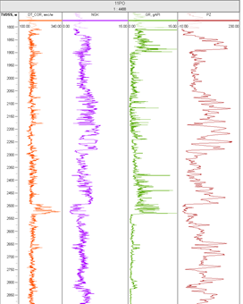

# Прогноз значений акустического каротажа (АК) методами машинного обучения

Проект посвящен реконструкции пропущенных геофизических данных в интервалах бурения. Основная цель — синтез кривой акустического каротажа для скважины **2PO** на основе статистических связей, выявленных в опорной скважине **11PO**.

## Описание задачи
Восстановление данных ГИС (геофизических исследований скважин) необходимо для уточнения петрофизических свойств пласта и корректной привязки сейсмических данных. В рамках работы решается задача регрессии: на входе данные радиоактивных и электрических методов, на выходе — интервальное время пробега волны (АК).

## Структура данных
Для обучения модели используются данные скважины **11PO**, включающие:
* **ГК** — гамма-каротаж;
* **НГК** — нейтронный гамма-каротаж;
* **ПЗ** — потенциал самопроизвольной поляризации;
* **АК** — акустический каротаж (целевая переменная).

Прогноз осуществляется для скважины **2PO** по имеющемуся набору признаков (ГК, НГК, ПЗ).

## Технологический стек
* **Язык:** Python
* **Библиотеки:** Pandas, NumPy (анализ данных), Scikit-learn (ML алгоритмы), Matplotlib/Seaborn (визуализация геофизических планшетов).

## Алгоритм реализации
1. **Препроцессинг:** Очистка данных от артефактов бурения, нормализация признаков.
2. **Анализ:** Изучение кросс-плотов и корреляций между каротажами.
3. **Моделирование:** Обучение и подбор гиперпараметров (Linear Regression, Random Forest или Gradient Boosting).
4. **Оценка:** Валидация точности прогноза на проверочных интервалах с использованием метрик $R^2$, MAE и RMSE.

## Результаты
В результате работы получена синтетическая кривая АК для скважины **2PO**, которая с высокой точностью повторяет литологические особенности разреза.

---
## Автор
Илья Цыбаков (учебный проект)
